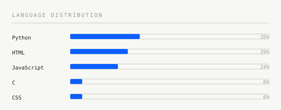
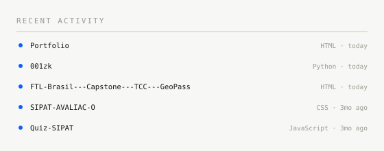

<picture>
<source media="(prefers-color-scheme: dark)" srcset="assets/living-system-dark.svg">
  <source media="(prefers-color-scheme: light)" srcset="assets/living-system-light.svg">
  
</picture> <table>
<tr>
<td width="33%"><picture>
  <source media="(prefers-color-scheme: dark)" srcset="assets/panel-languages-dark.svg">
  
</picture></td>
<td width="33%"><picture>
  <source media="(prefers-color-scheme: dark)" srcset="assets/panel-activity-dark.svg">
  
</picture></td>
<td width="33%"><picture>
  <source media="(prefers-color-scheme: dark)" srcset="assets/panel-streak-dark.svg">
  
</picture></td>
</tr>
</table> <div align="center">

[**OPEN SYSTEM ↗**](https://001zk.github.io)

</div>

---

## SYSTEM

`001ZK // LIVING SYSTEM` representa meus repositórios públicos como um sistema conectado — não como uma timeline, mas como uma arquitetura. Os cinco planetas são selecionados automaticamente pela API do GitHub e seu raio acompanha o tamanho real do repositório.

```
REPOSITORY ── REPOSITORY ── REPOSITORY ── REPOSITORY ── REPOSITORY
```

---

## EXPERIENCE

**CURRENT NODE**
Minsait / Indra Company — Analista de Suporte de TI Jr

**PREVIOUS NODE**
Arroba Banda Larga — Analista de NOC / TI Interno
`GPON` `EPON` `OLT` `ONU` `Zabbix` `IXC` `Proxmox` `VPN` · N2/N3 support, network troubleshooting, corporate IT infrastructure.

---

## ENGINEERING

| Repository node | Live data |
| --- | --- |
| `REPO/01..05` | Nome, linguagem, estrelas e tamanho real de cada repositório selecionado |

Os dados acima são regenerados em [`data/repos.json`](data/repos.json) pelo [workflow automático](.github/workflows/update-system.yml). O ranking considera os repositórios públicos próprios e não arquivados, ordenados pelo tamanho retornado pela API do GitHub.

**Education**
Engenharia de Software — Estácio de Sá (cursando)
Técnico em Informática — concluído

---

## RESEARCH

**R-01 / RESEARCH NODE — REUSABLE COMPUTING**
[*Manual de Montagem de um Computador Reciclável Utilizando Peças Reaproveitadas*](https://zenodo.org/records/18135901)
`HARDWARE` `REUSE` `SUSTAINABILITY` · publicado no Zenodo

---

## CERTIFICATIONS

**C-01** — OCNA Wireless — TP-Link
**C-02** — Ignite Brasil — Empreendedorismo — Wadhwani Foundation

---

## PROJECTS

Configurados em [`data/projects.json`](data/projects.json) — atualizados sem tocar no README.

---

## TECHNOLOGY

`Python` `Node.js` `JavaScript` `Google Apps Script` `Linux` `Git` `GitHub`

---

## CONTACT

GitHub: [@001zk](https://github.com/001zk) · [@Luiz-alt001](https://github.com/Luiz-alt001)
LinkedIn: [Luiz Gustavo de Barros](https://www.linkedin.com/in/luiz-gustavo-de-barros/)
Portfolio: [portfolio-luizs-projects-9a2b01d1.vercel.app](https://portfolio-luizs-projects-9a2b01d1.vercel.app/)

---

<sub>SYSTEM REV. 2026.08 · BUILD 001ZK — gerado a partir de <a href="data/profile.json">data/profile.json</a> via <a href="scripts/generate_system.py">scripts/generate_system.py</a>. Nenhuma métrica é inventada: campos sem dado real exibem <code>N/A</code>.</sub>

---

<details>
<summary><sub>Setup do GitHub Pages (OPEN SYSTEM)</sub></summary>

O `index.html` já está pronto na raiz do repositório, mas o GitHub Pages
precisa ser habilitado manualmente uma vez:

1. No repositório, vá em **Settings → Pages**

1. Em **Source**, selecione **Deploy from a branch**

1. Branch: **main**, pasta: **/ (root)** → **Save**

1. Aguarde 1–2 minutos e acesse `https://001zk.github.io`

Para sincronizar manualmente ou testar localmente:

```bash
python3 scripts/fetch_repos.py
python3 scripts/generate_system.py
python3 scripts/generate_web.py
```

</details>
