<picture>
<source media="(prefers-color-scheme: dark)" srcset="assets/living-system-dark.svg">
  <source media="(prefers-color-scheme: light)" srcset="assets/living-system-light.svg">
  
</picture> <div align="center">

[**VER MAPA DE PROJETOS ↗**](https://001zk.github.io/001zk/)

</div>


### LINGUAGENS MAIS USADAS


### ATIVIDADE RECENTE


### SEQUÊNCIA DE CONTRIBUIÇÃO


---

## SOBRE

Sou Luiz Gustavo, estudante de Engenharia de Software e Analista de Suporte de TI Jr. Trabalho com suporte, redes, infraestrutura, automação e desenvolvimento de soluções web.

O mapa acima seleciona automaticamente cinco repositórios públicos da minha conta no GitHub. O tamanho de cada planeta acompanha o tamanho real do repositório, enquanto a página interativa permite abrir cada projeto diretamente.

---

## EXPERIÊNCIA

**Minsait / Indra Company** — Analista de Suporte de TI Jr

**Arroba Banda Larga** — Analista de NOC / TI Interno

Experiência com `GPON` `EPON` `OLT` `ONU` `Zabbix` `IXC` `Proxmox` `VPN`, troubleshooting de redes, infraestrutura corporativa e suporte N2/N3.

---

## SKILLS

### SUPORTE & INFRAESTRUTURA

`Redes` · `NOC` · `GPON` · `EPON` · `OLT` · `ONU`
`Zabbix` · `Proxmox` · `Linux` · `VPN` · `N2/N3`

### DESENVOLVIMENTO & AUTOMAÇÃO

`Python` · `JavaScript` · `Node.js`
`Google Apps Script` · `APIs` · `Git` · `GitHub`

---

## PROJETOS EM DESTAQUE

### [abracadabra](https://github.com/001zk/abracadabra)

Plataforma gamificada de educação Web3 que guia iniciantes por aulas, quests e interações verificáveis na Solana Devnet.

`Next.js` `React` `TypeScript` `Solana` `Tailwind CSS`

### [GeoPass](https://github.com/001zk/FTL-Brasil---Capstone---TCC---GeoPass)

WebGIS para prever, consultar e visualizar passagens de satélites sobre locais escolhidos, combinando mapas e dados orbitais.

`Python` `Flask` `JavaScript` `Leaflet` `Skyfield` `SGP4`

### [CGNAT-AUDIT-PUBLIC](https://github.com/001zk/CGNAT-AUDIT-PUBLIC)

Ferramenta de auditoria CGNAT que correlaciona logs de acesso com ranges de portas para identificar o IP privado de origem.

`Python` `pandas` `openpyxl` `JSON`

14 repositórios públicos · 5 projetos no mapa · sincronização automática diária

Os repositórios do mapa são detectados pela API do GitHub e registrados em [`data/repos.json`](data/repos.json). Os projetos destacados são mantidos em [`data/projects.json`](data/projects.json).

---

## PESQUISA

**R-01 — REUSABLE COMPUTING**

[*Manual de Montagem de um Computador Reciclável Utilizando Peças Reaproveitadas*](https://zenodo.org/records/18135901)

`HARDWARE` `REUSE` `SUSTAINABILITY` · publicado no Zenodo

---

## FORMAÇÃO

Engenharia de Software — Estácio de Sá, cursando

Técnico em Informática — concluído

---

## CERTIFICAÇÕES

**OCNA Wireless** — TP-Link

**Ignite Brasil — Empreendedorismo** — Wadhwani Foundation

---

## CONTATO

[GitHub](https://github.com/001zk) · [LinkedIn](https://www.linkedin.com/in/luiz-gustavo-de-barros/) · [Portfólio](https://portfolio-luizs-projects-9a2b01d1.vercel.app/)

---

<sub>Sistema atualizado automaticamente a partir dos dados públicos do GitHub. A geração usa <a href="scripts/fetch_repos.py">scripts/fetch_repos.py</a>, <a href="scripts/generate_system.py">scripts/generate_system.py</a> e <a href="scripts/generate_web.py">scripts/generate_web.py</a>.</sub>

---

<details>
<summary><sub>Execução manual</sub></summary>

```bash
python3 scripts/fetch_repos.py
python3 scripts/generate_system.py
python3 scripts/generate_web.py
python3 scripts/validate_assets.py
```

O workflow do GitHub Actions executa esse processo automaticamente todos os dias e também pode ser iniciado manualmente em **Actions → update-system → Run workflow**.

</details>
